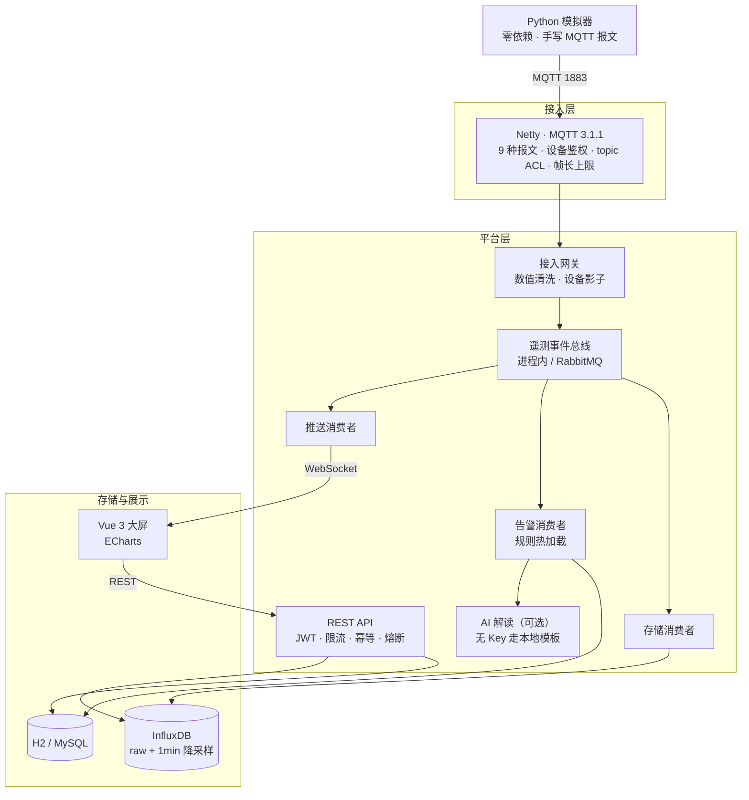

# 智慧农业云管端一体化平台

个人练习项目：用 Java 写一个 MQTT 设备接入 → 时序存储 → 告警判定 → 实时推送的完整链路，配一个 Vue 3 大屏。

> **先说边界**：这是在一台开发机上写完并跑起来的练习项目。**没有生产部署，没有真实硬件接入**。
> InfluxDB / RabbitMQ / MySQL 只有代码和单元测试，没有实际起过服务。
> 哪些验过、哪些没验过，见「[能力边界](#能力边界)」。

## 架构



## 技术栈

| 层 | 技术 |
|---|---|
| 后端 | Spring Boot 3.2 / Java 21 |
| 设备接入 | Netty 4.1，自己写的 MQTT 3.1.1 编解码（没用现成 broker） |
| 时序存储 | InfluxDB 2.x，Flux Task 做 1 分钟均值降采样 |
| 缓存 | Redis 存设备影子；无 Redis 时降级进程内 Map |
| 消息 | 进程内总线 / RabbitMQ，由 `mq.enabled` 切换，业务代码不改 |
| 安全 | Spring Security + JWT；设备侧是「设备 ID + 密钥」 |
| 容错 | resilience4j 熔断、令牌桶限流、幂等回执、降级可恢复 |
| 前端 | Vue 3 + Vite + Element Plus + ECharts |

## 主要功能

1. **MQTT 接入层** — Netty 手写 9 种报文编解码、长连接管理、心跳保活。设备鉴权用 username/password，校验失败返回 CONNACK(4)；topic 级 ACL 限制设备只能读写自己名下的主题；单帧长度有上限，避免设备侧发超大包把服务端内存打满。
2. **时序存储与降采样** — 遥测写 InfluxDB 原始库，Flux Task 每分钟算一次均值写入降采样库，长周期查询改读降采样层。InfluxDB 不可用时降级到内存缓冲，恢复后补写并记录空洞区间。
3. **告警引擎** — 规则存库并热加载到内存，支持「条件持续 N 秒才触发」；触发后写记录，条件恢复自动置 RESOLVED。改规则不用重启。
4. **实时推送** — WebSocket 把遥测、告警、连接状态广播给所有在线大屏。
5. **AI 告警解读** — 告警触发后调大模型生成「可能原因 / 影响 / 处置建议 / 是否需人工」，结果流式推给前端。有独立线程池、同规则 60 秒节流、熔断三道保护；没配 API Key 时走本地模板并明确标记为未调用模型，不把兜底包装成 AI 输出。

## 快速开始

```bash
git clone https://github.com/tangshi9527/smart-agriculture-platform.git
cd smart-agriculture-platform

# 后端（无需本机装 Maven，用 wrapper）
./mvnw spring-boot:run          # HTTP 8080，MQTT 1883

# 前端
cd frontend && npm install && npm run dev
```

不配任何环境变量也能启动——`application.yml` 里所有凭据都是 `${ENV:演示默认值}`。
要改就 `cp .env.example .env`。想一次起全部依赖（InfluxDB + Redis + RabbitMQ + MySQL）：
`docker compose up -d`。

主要接口（除登录外都需要 `Authorization: Bearer <token>`）：

| 接口 | 说明 |
|---|---|
| `POST /api/auth/login` | 登录拿 JWT |
| `GET /api/system/health` | 健康状态（降级原因、队列积压、脏数据计数都在这里） |
| `GET /api/telemetry/{deviceId}?range=-1h` | 遥测查询，支持原始库 / 降采样库 |
| `GET /api/telemetry/benchmark` | 两种查询路径的耗时对比 |
| `GET/POST /api/alerts/rules` | 告警规则查询与保存 |
| `POST /api/ai/explain` | 手动触发一条告警的 AI 解读 |
| `POST /api/simulator/start` | 拉起 Python 模拟器 |

## 能力边界

### 验过的

| 项 | 结果 |
|---|---|
| MQTT 接入规模 | 本机 loopback 模拟器，1000 连接 / 500 设备同时在线 |
| WebSocket 吞吐 | 单客户端约 573 条/秒（自写 WS 客户端计数） |
| Redis 设备影子 | 本机真实 Redis 实例，读写正常 |
| 告警热更新 | 新增规则后立即生效，无需重启 |
| 单元测试 | 23 个测试类 / 83 个用例，`./mvnw test` 全绿 |

### 没验过的

| 项 | 说明 |
|---|---|
| **InfluxDB 真实读写与降采样** | 全程走内存降级路径。写入、Flux Task 创建、retention、补算逻辑只在单元测试和 mock 上验证过，**Flux 脚本没在真实实例上执行过** |
| **RabbitMQ** | 只有 `rabbitmq-mock` 内存版集成测试，没连过真 broker |
| **MySQL** | 配了 profile，没实际跑过，全程用 H2 |
| **真实硬件** | 没有。所有「设备」都是 Python 脚本在 loopback 上模拟 |
| **压测与长时间稳定性** | 没有压测报告。1000 连接是功能验证规模，不是性能结论；也没有 24 小时以上的长跑数据 |
| **生产部署** | 没有 |

1000 连接这个数字证明了 Netty 能同时持有 1000 个 TCP 连接并正确处理报文，没在连接数上出现明显瓶颈；
但它**不证明**真实网络下的接入能力——全在 loopback，没有 RTT、丢包重传、NAT 超时、弱网重连。

## 已知限制

| 项 | 现状 |
|---|---|
| MQTT QoS 2 / 离线消息 / 会话持久化 | 只实现了 QoS 0/1 报文层 |
| TLS | MQTT 明文 1883，未配证书 |
| 设备密钥存储 | 比较用了恒定时间实现，但库里仍是明文 |
| 单实例 | 长连接路由表在进程内存里，多节点无法跨节点下发指令 |
| 告警消除通知 | 记录状态能自动置 RESOLVED，但没有「告警已消除」的推送 |
| 测试覆盖率 | 未接 JaCoCo，真实覆盖率未知 |

## 目录结构

```
src/main/java/com/smartagri/
├── mqtt/        Netty MQTT 编解码 + 长连接管理
├── ingest/      接入网关（数值清洗 + 设备影子）
├── mq/          遥测事件总线 + 三个消费者（存储 / 告警 / 推送）
├── influx/      InfluxDB 写入、查询、降采样、降级恢复
├── alert/       告警引擎 + 规则 + 记录
├── device/      遥测模型、设备影子、设备密钥
├── gateway/     API 治理（版本化 / 限流 / 幂等 / 熔断 / 指标）
├── ai/          大模型告警解读
├── auth/        JWT 认证
├── websocket/   实时推送
├── simulator/   模拟器编排（拉起 Python 脚本）
└── controller/  REST 接口
frontend/        Vue 3 大屏
simulator/       device_sim.py（零依赖 Python 模拟器）
scripts/         启动与验证脚本
```

规模：105 个主代码类 / 约 8300 行，23 个测试类 / 83 个用例。
CI（`.github/workflows/ci.yml`）跑后端测试 + 打包、前端构建。
